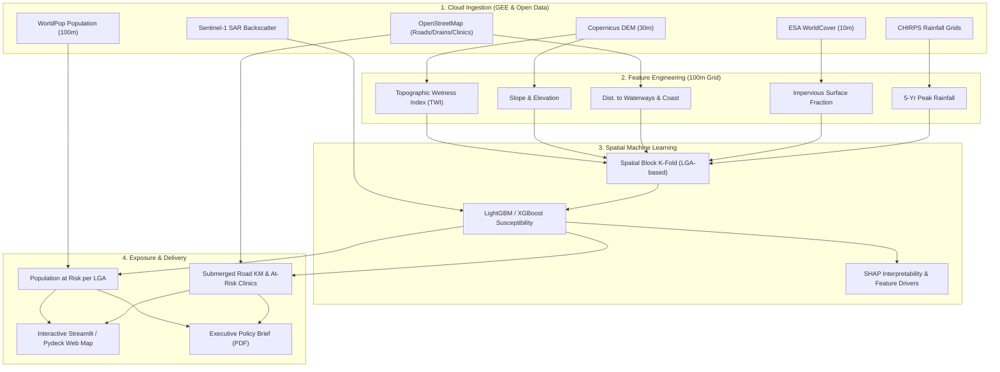

# Lagos Flood Risk & Population Exposure Mapping (100m Grid)

[](https://www.python.org/)
[](https://opensource.org/licenses/MIT)
[](https://streamlit.io/)

A high-resolution, open-source geospatial machine learning pipeline and interactive web map predicting neighborhood-level flood susceptibility (~100m grid) and quantifying population and critical infrastructure exposure across all 20 Local Government Areas (LGAs) of Lagos State, Nigeria.

---

## 📌 Executive Summary

Flooding is an annual humanitarian and economic crisis in Lagos State, driven by sea-level rise, low elevation, high rainfall intensity, and rapid, unplanned urban expansion. While national agencies such as NIHSA and NiMet publish broad regional flood outlooks, **hyper-local, neighborhood-level risk tools are scarce**.

This project bridges that gap by delivering:
1. **100m Predictive Flood Susceptibility Model**: Integrating Sentinel-1 SAR flood extents, Copernicus DEM terrain indices (TWI, slope, elevation), ESA WorldCover imperviousness, and CHIRPS precipitation.
2. **Spatial Autocorrelation-Resistant Validation**: Evaluated using **Spatial Block Cross-Validation** (LGA-based GroupKFold) to prevent spatial data leakage.
3. **Multi-Sector Exposure Assessment**: Quantifying exposed population (WorldPop 100m), primary/secondary road networks, and health clinics per LGA.
4. **Interactive Decision Dashboard**: A web map for emergency responders, urban planners, and state agencies (e.g., Lagos State Ministry of the Environment).
5. **One-Page Policy Brief**: Executive recommendations for targeted drainage infrastructure investment and desilting prioritization.

---

## 🏗️ Architecture & Pipeline



---

## 📊 Data Sources (100% Free & Open Access)

| Category | Source | Resolution | Processing Method |
| :--- | :--- | :--- | :--- |
| **Terrain & Hydrology** | Copernicus GLO-30 DEM | 30m | GEE + Local derivation of Slope, Aspect, and TWI |
| **Flood Extent Labels** | Sentinel-1 SAR (GRD C-band) | 10m | Cloud backscatter change detection (VV/VH polarization) |
| **Imperviousness** | ESA WorldCover v200 | 10m | Resampled to 100m built-up surface density |
| **Rainfall** | CHIRPS Daily Precipitation | 0.05° (~5km) | Spatial interpolation of multi-year 3-day max extreme events |
| **Population** | WorldPop Constrained | 100m | Zonal statistics against high-risk flood masks |
| **Infrastructure** | OpenStreetMap (OSM) & GRID3 | Vector | Distance buffering & overlay for roads, waterways, clinics |
| **Administrative** | geoBoundaries / GRID3 Nigeria | Vector | State and LGA boundary shapefiles |

---

## 🔬 Spatial Machine Learning Methodology

### Preventing Spatial Data Leakage
Standard random train-test splitting in geospatial data causes severe optimistic bias due to Tobler's First Law of Geography ("near things are more related than distant things"). 
In this project, we implement **Spatial Block Cross-Validation** (grouping contiguous Local Government Areas). The model is tested on spatial regions it has never observed during training, ensuring genuine real-world generalization.

### Model Interpretability via SHAP
Feature attribution reveals the primary localized drivers of flooding in Lagos:
- **Low elevation + high TWI** dominate risk in coastal and lagoon-bordering LGAs (e.g., Eti-Osa, Lagos Island, Ibeju-Lekki).
- **High impervious surface fraction + poor drainage proximity** dominate pluvial flash flooding in dense inland LGAs (e.g., Mushin, Agege, Surulere).

---

## 📂 Project Organization

```text
lag_flood/
├── data/
│   ├── raw/                  # Downloaded raw boundaries, OSM extracts, and satellite rasters
│   ├── processed/            # Harmonized 100m feature grid, aligned rasters (UTM 31N)
│   └── exposure/             # LGA-level summary tables (population, roads, clinics)
├── src/
│   ├── config.py             # Constants, BBOX, CRS definitions (EPSG:4326, EPSG:32631)
│   ├── ingestion.py          # Boundary and open data downloaders
│   ├── features.py           # Topographic Wetness Index, slope, distance transforms
│   ├── model.py              # Spatial Block CV, LightGBM training, SHAP attribution
│   └── exposure.py           # Zonal statistics and critical infrastructure overlay
├── notebooks/                # Exploratory research notebooks
├── app/                      # Streamlit interactive application
│   ├── app.py                # Main web application entry point
│   └── components/           # Pydeck/Folium rendering components
├── reports/                  # 1-page executive policy brief and high-res figures
├── requirements.txt          # Reproducible dependency specification
└── README.md
```

---

## 🚀 Quickstart & Installation

### 1. Prerequisites
- Python 3.11+
- [Google Earth Engine](https://signup.earthengine.google.com/) account (free)

### 2. Setup
```bash
# Clone the repository
git clone https://github.com/Tiamz01/Lagos_flood_flood_risk_Assessment.git
cd Lagos_flood_flood_risk_Assessment

# Create and activate virtual environment
python -m venv venv
# On Windows:
.\venv\Scripts\activate
# On Linux/macOS:
source venv/bin/activate

# Install required packages
pip install -r requirements.txt
```

### 3. Initialize Data Pipeline
```bash
# Download Lagos State and LGA boundaries
python -m src.ingestion
```

### 4. Run Interactive Web Dashboard
```bash
streamlit run app/app.py
```

---

## 📑 Policy Brief Highlights

An executive one-page policy brief for state stakeholders (e.g., Lagos State Ministry of the Environment and Water Resources) is compiled in `reports/Lagos_Flood_Policy_Brief.pdf`.

Key findings:
- **High Exposure Clusters**: Over 65% of flood-exposed residential populations are concentrated across 5 key LGAs.
- **Critical Arterials**: Over 45 km of primary arterial roads are subject to seasonal inundation, threatening inter-district supply chains.
- **Healthcare Accessibility**: Identified 14 primary healthcare clinics within flash flood corridors lacking elevated access paths.

---

## ⚖️ Limitations & Ethical Considerations
- **Ground Truth Sparsity**: Nigeria lacks dense hydrometric stream gauges. Sentinel-1 SAR change detection captures visible open-water flooding well, but can under-detect sub-canopy and narrow street-level flash floods. Documenting these uncertainties is central to responsible geospatial decision-making.

---

## 👨‍💻 Author & Contact
- **Project Lead**: Tiamz01 (Geospatial Data Science & Earth Observation)
- **GitHub**: [github.com/Tiamz01](https://github.com/Tiamz01)
